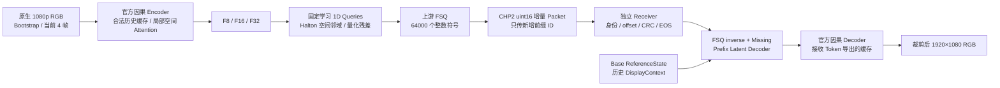

# CHP-VTok 实现与实测报告

日期：2026-11-14。主仓库：`/home/whisperliang/InfoTok`，开发分支 `chp-vtok`。实现代码提交：`d9a43cae426c9a7be3abc5ef49f31154b153ac0a`。上游基线：`042fc5815717ee34d7281e7eb2971ad9c9d76421`。

**交付的是已运行、已短训练的研究工程实现。原生 1080p 几何、双端时间因果、独立块预算、唯一整数序列前缀和独立 TCP Receiver 已验证；FP32 的完整计算与真实缓存执行通过实测一致性。模型尚未收敛，重建明显模糊，BF16 的完整/缓存离散 ID 不完全一致，也未达到实时。不能将这些结果解释为成熟的视频压缩模型或正式基准结论。**

## 1. 验收状态与执行 Gate

| 核心约束 | 实现/单元测试 | H100 与原生 1080p 实测 | 边界 |
|---|---|---|---|
| Native High-Resolution | 直接处理原始 RGB；仅内部 Padding/下采样 | Bootstrap 后 `[1,3,4,1080,1920]` 同尺寸重建；完整 17 帧通过 | 没有低分辨率外部超分、独立模型拼图或 RGB 复制；质量仍低 |
| Strict Temporal Causality | 卷积相位、逐时间归一化、因果 KV；编码/解码干预分测 | 修改未来 RGB，过去整数 ID 不变；修改未来 ID，过去重建最大差 0 | 因果单位为 Bootstrap + 4 帧块；允许块内依赖 |
| Variable-Length Discrete 1D | 固定学习查询，FSQ 整数 `[B,Kmax]`，显式 Missing | 256/512/1024/2048 均重建；混合预算 `[256,512,1024,2048,256]` TCP 通过 | 4096/8192 仅通过小模型结构/前缀测试，未完成 H100 训练与率失真 |
| Strict Prefix-Progressive | 每块只编码一次 Kmax，所有预算切同一条整数序列 | 256→512→1024→2048 只发送新增 ID；Receiver 最终 ID 与 Sender 完全相同 | 只支持有序块内增量；不支持跨块迟到增强、乱序和历史重放 |

| Gate | 状态 | 证据及未完成项 |
|---|---|---|
| 0 官方环境/权重 | 工程加载与原生 CLI 通过 | 官方 17 帧 FP32 推理成功；没有声称重现论文 TokenBench/DAVIS 全集指标 |
| 1 原生高分辨率骨干 | CHP 局部窗口架构通过 | 360p、720p、1080p；完整 17 帧 FP32 因果/对齐通过。原 ViT 未被宣称可直接运行 1080p |
| 2 单尺度 1D Token | 工程验收通过 | 短训练、真实重建、全预算梯度、整数 FSQ、严格前缀与 Missing 通过 |
| 3 多尺度/多预算训练 | 工程实验完成，正式训练未完成 | 真实率失真和单/多尺度消融已有；仅 40 步 debug + 2 步原生训练，没有收敛或泛化证据 |
| 4 缓存/增量/独立 Receiver | FP32 与协议通过；BF16 数值等价未通过 | 原生 17 帧缓存 ID 全等；CHP2 无未来包预读；真实 TCP/混合预算通过 |
| 5 未来收益/消融 | 小样本实验完成，正式验证未完成 | 六对历史干预、单/多尺度和 Halton/Morton 已测；保留负收益，无多种子、长序列和独立测试集结论 |

## 2. 上游审计与复现

已读取用户指定的 README、两个网络实现、官方配置、FSQ、`layers3d.py`、`layers3d_vit.py`、`utils.py`、推理库/CLI、原训练框架/配置以及两个官方实验脚本。逐项结论还记录于 [audit.json](/home/whisperliang/InfoTok/results/chp_vtok/audit.json)。

| 审计项 | 实际发现 |
|---|---|
| `OursDiscreteVideoTokenizer` | 原网络、配置名、训练配置、官方 checkpoint 入口继续存在；新增 CHP 用独立类与独立配置启用 |
| Encoder / Decoder | 官方 FACTORIZED 因果卷积对象及权重被直接复用。高分辨率 CHP 的空间 Attention 改为 16×16 局部窗口，属于架构变更 |
| `vit_encode` / `vit_decode` | 原路径仍包含稠密时间/空间组织和全局 block-causal Attention；原空间旋转位置缓冲为 96×96，时间位置表 49；不适用于直接照搬 136×240 原生潜在网格 |
| `adaptive_tokenize` / `mask_tokens` | 对连续稠密量化特征置零。MSE 排序还需要空间位置元数据，不能直接当作真实可传输 1D 前缀 |
| FSQ | `levels=[8,8,8,5,5,5]`，空间为 64000，固定打包 16 bit/ID；已穷举验证全部 64000 ID 双向映射 |
| 2D/1D 与 Learned Query | 原稠密网格、连续特征、未发送位置、学习查询与线上的整数序列明确区分；CHP 不发送稠密 Latent 或完整排序表 |
| block-causal Attention | 上游 mask 的 True 表示屏蔽；SDPA 的布尔 True 表示允许。新缓存掩码还包含合法历史的时间偏移 |
| 检查点训练范围 | 官方 Flex 说明为 81 帧、多分辨率、非正方形；未发现可验证的原生 1080p 预训练保证。配置名 256p 不等于完整训练分辨率清单 |
| 梯度 | 冻结 Encoder 可 `no_grad`；冻结 Decoder 仍保留输入梯度。RGB 损失可以反传至新恢复模块 |
| 原推理缓存 | 原推理按窗口/重叠运行，ViT 的缓存实现被注释。没有把它称为真流式；新 CHP 实现独立的真实算子缓存 |
| 归一化 | 实际骨干 `CausalNormalize(num_groups=1)` 已使用 `time2batch` 逐时间位置 GroupNorm，完整保留，未做无意义“因果修复” |

官方权重来自 [固定 HF revision](https://huggingface.co/qyoo/infotok-flex/tree/7b9f0d4d5b7ce128e7de0d4252f34199b9ac25f5)，文件 `checkpoints/infotok-flex/infotok_mse.pt`，1,725,353,482 字节，SHA256：

```text
bd69629a8f8fcfc4808d29eec5bed68177e22aa14e3b9b799599791e26af935a
```

仓库 LICENSE 和固定版本模型卡声明 Apache-2.0；`ours_discrete_video.py` 另保留了一段与根许可证表述不一致的旧 NVIDIA proprietary 文件头。该事实已记录，未擅自删除或改写其版权信息。`layers3d_vit.py` 本身为 Apache-2.0 文件头。

官方原生 CLI 已成功执行，官方权重 FP32、17 帧的模型 Padding 形状为 `[1,3,17,256,480]`，前向 2.1133 s、峰值 allocated 2.848 GB；输出见 `upstream_reproduced.json` 和 `upstream_cli_verified/`。修复了上游 `.to(dtype)` 位置参数调用导致 FSQ dtype 被错误恢复为 BF16 的问题，并先记录失败测试再修复。原模型可加载和推理，但 SDPA 的低精度 ID 变化见下一节，不承诺逐位复现。

## 3. Attention 数值与高分辨率内存

原空间 Attention 仍按时间位置独立，原 Q/K/V/输出投影、通道缩放和参数键不变。原时间 Attention 仍按空间位置独立且严格因果；dropout 保持 0。只将显式 bmm/softmax 数学计算替换为 SDPA。**该变更与 CHP 的局部窗口架构变更分别报告。**

串行、预热后的 H100 官方检查点对照，源视频缩至 256p、5 帧，记录于 `attention_uncontended.json`：

| 精度 | FSQ ID 变化比例 | RGB 最大/平均绝对差 | SDPA 编码/解码 s | 原显式编码/解码 s |
|---|---:|---:|---:|---:|
| FP32 | 0 | 1.4901e-6 / 9.5859e-8 | 0.14210 / 0.24312 | 0.14239 / 0.24412 |
| BF16 | 44.2969% | 0.322266 / 0.008423 | 0.06881 / 0.11456 | 0.06800 / 0.11419 |

单 Attention 模块的 FP32 最大前向误差约 2.38e-7–4.77e-7；输入/参数梯度误差与 FP16/BF16 数值均在 JSON 中。FP16 最大前向误差 0.001953，BF16 0.015625。小张量下没有可靠速度收益；SDPA 不保证每种形状都减少 allocated，也不保证离散 ID 不变。早期 `attention_warm_numerics.json` 与另一任务有 GPU 重叠，其延迟不用于结论；最终串行测量另存而未覆盖它。

CHP 在 F8 的每个时间位置按固定空间窗口执行 Attention，Slot 提取每个查询只访问 5×5 邻域，恢复每个位置只访问确定性的 8 个 Slot 邻居。没有在数万个原生空间位置之间构建全局稠密 Attention。原 ViT 和旧 2D bottleneck 不在 CHP 新路径上；这需要重新学习压缩器/恢复器，不能宣称等价转换。

完整 17 帧曾在 cuDNN 卷积 workspace 处申请额外 40.34 GiB 并 OOM。现按精确输出时间区间切分卷积，保留 kernel/dilation/stride/padding 数学定义。FP64 前向/反向数学测试通过；FP32/BF16 的调度误差分别实测，不伪装成逐位等价。完整原生 FP32 前向现已通过。

## 4. CHP-VTok 总体架构



单尺度：原生 F8 → 固定 Kmax 个学习查询 → 6 维 FSQ code → `[B,Kmax]` 整数 → Prefix Decoder 恢复稠密 256 通道潜在 → 官方 RGB Decoder。

多尺度：Base=256 使用 F32；Structure=768 使用 F16 残差；Detail=Kmax−1024 使用 F8 残差。Structure 的参考只来自**量化 Base 的恢复结果**；Detail 的参考只来自**量化 Base+Structure 的恢复结果**。接收端可恢复同一个参考，未使用编码器私有连续特征作为解码必需信息。K=512 的 256 个 Structure Token 可立即解码，K=1500 的部分 Detail 也通过合法性测试。

压缩阶段与最终传输预算无关，每块一次生成唯一完整序列；较小预算只切片。编码耗时因此仍包含最大预算计算。ID=0 是真实码字，Missing 通过独立长度/掩码和学习嵌入表示。分辨率与锚点算法由 Session/配置确定，无须发送空间排序表。

`ReferenceState` 只由每块最前 256 个基础 ID 构造并在块关闭时提交一次；历史增强只进入 `DisplayContext`，通过学习投影影响显示潜在，不改写基础卷积参考版本。当前协议依赖可靠有序连接，不含应用层丢包 ACK/恢复机制；跨块迟到增强明确不支持。

| 模型 | 总参数 | 当前冻结骨干阶段可训练参数 |
|---|---:|---:|
| 官方 InfoTok | 123,142,646 | 官方模型本身 123,142,646 |
| CHP Single | 113,474,806 | 858,374 |
| CHP Multi | 113,880,834 | 1,264,402 |

共享卷积 Encoder/Decoder 合计 112,616,432 参数。不同结构可训练参数量不同，固定字节消融不是参数量匹配的因果实验。

## 5. 复用、替换与文件

实际复用：`OursDiscreteVideoTokenizer` 对应的卷积 Encoder/Decoder 对象、`FSQuantizer`、原 RGB/感知 Loss、`TokenizerModel`、`TokenizerTrainer`、AdamW 构造、WarmupCosineLR 和 Checkpoint Manager。没有复制出第二套训练器或旧模型实现。

仅对新模型替换：原 ViT、原路由/二维 mask bottleneck、原 quant_conv/post_quant_conv 的压缩恢复路径，改用新的 1D 学习模块。其 RGB Decoder 输入仍为官方要求的稠密潜在，但通过公开离散前缀学习恢复。`L_latent` 目标是因果 Encoder 的 F8 特征；它不是旧 ViT 后特征的等价蒸馏，这也是当前重建分布尚未对齐的限制。

| 文件/目录 | 作用 |
|---|---|
| `progressive/model.py`, `config.py` | 新模型、原生几何、量化残差、嵌套预算、RGB 梯度路径 |
| `progressive/causal_state.py` | 真实卷积/采样相位/Bootstrap/池化/上采样/KV 缓存；有限卷积 workspace；无状态梯度检查点 |
| `progressive/anchors.py`, `feature_pyramid.py` | 矩形 Halton/BFS Morton，F8/F16/F32，仅空间降采样 |
| `progressive/slot_compressor.py`, `latent_decoder.py`, `quantizer.py` | 固定查询、受限邻域、真实 FSQ、Missing、前缀恢复 |
| `progressive/stream.py` | Bootstrap/4 帧接口，Base Reference/Display，显式尾帧有效数 |
| `progressive/protocol.py`, `transport.py`, `cli.py`, `checkpoint.py` | CHP2/CHPB、uint16、CRC、文件/TCP Sender/Receiver、公开 Decoder 导出 |
| `training/chp_model.py`, `chp_losses.py` | 扩展原训练模型、RNG/哈希回调、原像素区域感知训练 Loss |
| `training/configs/chp_vtok.py`, `datasets/chp_video.py` | A/B/C/D 独立配置，原生视频数据，显式 debug resize/crop |
| `exp_scripts/chp_vtok_train.sh` | 原 Trainer 的 torchrun 入口；venv 内 CUDA runtime 链接 |
| `modules/layers3d.py` | 上游 Attention 的数学等价 SDPA 重构，参数键不变 |
| `networks/ours_discrete_video.py` | 修复位置参数 `.to(dtype)` 的量化器 dtype 同步 |
| `scripts/chp_*.py`, `chp_extra_evaluations.sh` | 数值、原生几何、缓存、训练内存、传输、质量、ROI、图表和清单的可执行实验 |
| `tests/test_chp_*.py` | 因果、前缀、量化残差、梯度、恢复、协议错误和端到端文件接口 |

完整新增/修改文件及逐文件 SHA 在 `source_hashes.json`，可审查差异在 `implementation.diff`。本次没有写入独立 benchmark 仓库；只读取其已有公开 YUV 和 ub 工具可执行文件，所有模型、训练、结果及 `.metrics` 写在 InfoTok 内。

## 6. 训练、恢复与权重

使用原 InfoTok 训练入口，RGB L1 + 上游 VGG 感知训练损失（权重 0.1）+ 潜在 MSE（权重 1）+ 时间差 L1（权重 0.1）+ 原生 FSQ 辅助项（恒为 0）。训练的 VGG 感知损失与评估的标准 AlexNet LPIPS 分开。没有熵模型或假想的熵流截断。

每个历史块独立随机抽取 256/512/1024/2048，而非始终完整历史。所有允许预算均验证了 Loss 有限、整数 ID 范围正确、Compressor/Latent Decoder 有效梯度，以及被冻结 RGB Decoder 没有参数梯度。

| 阶段/权重 | 实际运行 | 用途与限制 |
|---|---|---|
| Single A | 40 步 256p/5 帧 debug + 恢复到 42 步的完整 1080p/5 帧训练 | 单尺度 RD 使用 step 42 |
| Multi B | 同样 40 + 2 步原生训练 | 多尺度 RD、缓存与传输使用 step 42 |
| 长历史 C | 从 Multi 42 恢复到 44；完整 `[1,3,17,1080,1920]` | 真实全 RGB、全时间损失；感知项采样真实 256×256 区域；不混入 42 步的公平消融 |
| Morton 对照 | 40 + 2 步，相同课程和预算 | MCL-JCV01 原生 17 帧锚点消融 |
| 可选 D | 从 Multi 42 仅加载权重；2 步真实 512×512 像素裁剪，LR=1e-5 | 当前解冻整个卷积骨干；只证明微调路径，不是完整 1080p 质量结果 |

完整 17 帧的全帧 VGG 感知训练曾 OOM：已有 73.98 GiB allocated，额外申请 4.20 GiB。修复方案保留完整 RGB 输出与损失，非重入 checkpoint 覆盖重复前缀 Decoder；仅感知项改成时间共享、均匀采样的真实 256×256 区域，无 resize。43/44 步耗时 38.99/36.71 s，峰值 64.19/64.27 GB；区域坐标与源几何逐步记录，不能把该目标称为全帧 LPIPS 训练。

Checkpoint 内保留 Model、Optimizer、Scheduler、GradScaler、Python/NumPy/CPU/CUDA RNG、Global Step、模型配置 SHA、完整训练 YAML SHA；另有 checkpoint SHA sidecar。42→44 恢复实际运行通过。任意 DataLoader 中途位置并未做精确重放，因此没有宣称整个恢复轨迹逐位相同。微调导致优化器参数组改变，只允许配置相同且冻结策略改变的 weights-only 初始化；普通恢复仍严格检查模型配置。

关键文件：

| 权重 | SHA256 |
|---|---|
| `single_native/.../iter_000000042.pt` | `d5fc365f92bad72bc3d2b1e93ddb0203ee450872ff374ba5f174cdc191394ea1` |
| `multi_native/.../iter_000000042.pt` | `6d94c620a276f2baf215512bd5ea775dd6bc4e6ead35625ab279fd92ed6bb79d` |
| `multi_native17_sampled/.../iter_000000044.pt` | `c2e2680f0f016059ec883dc98574c0a30de7c6b87f195b165fc5142e0ff6902f` |
| `morton_native/.../iter_000000042.pt` | `44a0c0d815831dec819afb74bff5f66c68048144f193332fb29a20ac0a7d5050` |
| `multi_decoder.pt` 公开接收端 | `e0a8d43c7fd4dccd646d9bd397671451006d319b2c136f5b5c36a5061a3af32d` |

上述相对目录均在 `/home/whisperliang/InfoTok/checkpoints/chp_vtok/` 下，训练模型另包含 `tokenizer/` 层。11 份完整清单和绝对路径见 [checkpoint_manifest.json](/home/whisperliang/InfoTok/results/chp_vtok/checkpoint_manifest.json)。权重与大型 RGB 张量保存在本机并从 Git 排除，未上传；原 checkpoint 未删除。所有训练 config 和可用 step 日志另归档于 `training/`。

## 7. 原生几何与真实流式

环境：H100 PCIe 80GB，driver 580.159.03，PyTorch 2.6.0+cu124，CUDA runtime 12.4，Python 3.10.12。完整依赖为 `dependencies.txt`，设备原始信息为 `device.txt`。原 `requirements.txt` 未更改。独立 venv 的 W&B/Protobuf、Megatron、CUDA runtime 问题及修复均保留日志。

早期纯连续卷积骨干几何测试（局部窗口架构，**没有**离散传输质量含义）：

| 输入源与帧数 | Padding 后输入 / 原生裁剪输出 | 潜在网格 | 结果 |
|---|---|---|---|
| 360p FP32，17 帧 | 384×640 / 360×640 | 5×48×80 | 完整/缓存形状通过 |
| 720p BF16，5 帧 | 736×1280 / 720×1280 | 2×92×160 | 完整/缓存形状通过 |
| 1080p BF16，5 帧 | 1088×1920 / 1080×1920 | 2×136×240 | 编码 1.198 s / 7.478 GB，解码 1.824 s / 8.696 GB |

旧 `backbone_*.json` 中个别早期 `roundtrip_is_lossy=false` 元数据措辞有误，其实际含义只是“未施加离散量化”；卷积重建不是无损。当前脚本使用 `quantization_applied=False` 明确表达；这些文件不能充当 tokenizer 的重建质量结果。

真正的模型级流式缓存覆盖所有选用因果算子：卷积历史长度由 receptive interval 与下一输出窗口/stride 相位推导；Bootstrap 只初始化一次；时间下采样池化、上采样裁剪、Haar patch/unpatch 均保存相位；Temporal Attention 保存完整历史 KV。ViT 被新模块替换，因此没有声称缓存已不存在的新路径。缓存只有合法历史特征，没有原始 RGB；逻辑缓存字节可测，KV 随会话长度增长。

原生 17 帧 Multi42，混合预算 `[256,512,1024,2048,256]`，三种执行模式实测：

| 项目 | FP32 | BF16 |
|---|---:|---:|
| 完整 vs 合法历史重算：ID 差异 | 0 | 0.048828% |
| 完整 vs 缓存复用：ID 差异 | 0 | 0.273437% |
| 完整 vs 缓存 RGB 最大/平均绝对差 | 1.0133e-6 / 1.0524e-7 | 0.0234375 / 0.000705719 |
| 完整 / 重算 / 缓存编码 s | 5.588 / 11.511 / 6.469 | 3.590 / 5.597 / 4.345 |
| 完整 / 缓存解码 s | 23.748 / 25.841 | 10.078 / 16.113 |
| 完整 / 缓存编码峰值 GB | 35.72 / 18.96 | 18.66 / 11.10 |
| 完整 / 缓存解码峰值 GB | 52.29 / 46.31 | 26.96 / 24.77 |
| Encoder / Decoder 逻辑缓存 GB | 8.89 / 12.40 | 4.45 / 6.20 |

Encoder/Decoder 分别有 54/65 个缓存条目，仅消耗 17 个新帧。缓存编码比重复合法历史快，但并不必然快于一次完整批量计算；解码还需要构造并提交 Base 参考，不能声称“加缓存一定加速”。逻辑缓存字节不等于 allocator 的 allocated/reserved；原始性能 JSON 同时给出 baseline 与实际峰值。以上只有一次有限长度实测，不是任意长输入的全称数值证明。

冻结 Decoder 的原生 5 帧反传保护：开启 checkpoint 为 22.81 GB / 3.891 s，关闭为 57.45 GB / 2.312 s；RGB 前向差和输入梯度差均为 0，输入梯度范数 0.00787007，所有梯度有限，Decoder 参数无梯度。新模块的真实训练梯度范数另在日志记录。代价是重算时间。

## 8. 真实重建与率失真

三段源视频均直接来自已有 1920×1080 YUV：MCL-JCV01（30 FPS）、UVG Beauty（120 FPS）、BasketballDrive（50 FPS）；提取 17 帧无损 RGB 容器，未缩放。它们也用于短训练，**没有独立测试集，也没有推广性结论**。完整命令、源路径与提取文件 SHA 在 `data_manifest.json`。

正式质量表使用**原始 FP32 RGB 参考**和已经保存的真实 BF16 模型重建张量。最初评测曾把参考也转成 BF16，旧记录保留于 `reconstructions/rd_*/metrics.json`，不作为最终指标；重算结果位于 `quality_reference_fp32/`，性能及码流字节仍追溯原执行记录。没有重新生成 Token 或用模拟图替代。

PSNR 为各帧 RGB MSE 的 dB 均值；SSIM 使用 skimage RGB channel 方式、`data_range=1`；LPIPS 为标准 alex v0.1；DISTS 使用包内预训练权重。两种感知评估均输入完整原生帧，未走 PIL resize 预处理。评估只对 RGB 合法值域作统一 clamp，没有拟合单调曲线、取最佳前缀或裁掉负收益。

**mcl_jcv01：完整 17 帧、原始 FP32 RGB 参考。**

| 模型 | K / 块 | Actual Bytes | PSNR dB | SSIM | LPIPS | DISTS |
|---|---:|---:|---:|---:|---:|---:|
| single | 256 | 3,216 | 19.8650 | 0.5977 | 0.6850 | 0.6700 |
| single | 512 | 5,776 | 20.3377 | 0.6085 | 0.6693 | 0.6539 |
| single | 1024 | 10,896 | 20.1706 | 0.6133 | 0.6431 | 0.6279 |
| single | 2048 | 21,136 | 19.3197 | 0.6056 | 0.6284 | 0.6016 |
| multi | 256 | 3,216 | 18.8053 | 0.5839 | 0.6652 | 0.6914 |
| multi | 512 | 5,776 | 19.3561 | 0.5952 | 0.6679 | 0.7066 |
| multi | 1024 | 10,896 | 19.2803 | 0.5980 | 0.6551 | 0.6977 |
| multi | 2048 | 21,136 | 19.1413 | 0.6127 | 0.6625 | 0.6906 |

**uvg_beauty：完整 17 帧、原始 FP32 RGB 参考。**

| 模型 | K / 块 | Actual Bytes | PSNR dB | SSIM | LPIPS | DISTS |
|---|---:|---:|---:|---:|---:|---:|
| single | 256 | 3,218 | 16.2989 | 0.5662 | 0.7521 | 0.6890 |
| single | 512 | 5,778 | 17.5501 | 0.5800 | 0.7314 | 0.6729 |
| single | 1024 | 10,898 | 19.7270 | 0.5871 | 0.7167 | 0.6545 |
| single | 2048 | 21,138 | 19.0924 | 0.5718 | 0.7241 | 0.6416 |
| multi | 256 | 3,218 | 19.5868 | 0.5958 | 0.7331 | 0.6743 |
| multi | 512 | 5,778 | 20.1519 | 0.6262 | 0.7263 | 0.6858 |
| multi | 1024 | 10,898 | 19.8479 | 0.6129 | 0.7256 | 0.6798 |
| multi | 2048 | 21,138 | 20.0333 | 0.5959 | 0.7253 | 0.6812 |

**basketball：完整 17 帧、原始 FP32 RGB 参考。**

| 模型 | K / 块 | Actual Bytes | PSNR dB | SSIM | LPIPS | DISTS |
|---|---:|---:|---:|---:|---:|---:|
| single | 256 | 3,216 | 11.0909 | 0.5005 | 0.8910 | 0.7758 |
| single | 512 | 5,776 | 12.2838 | 0.5432 | 0.8821 | 0.7593 |
| single | 1024 | 10,896 | 14.6779 | 0.5959 | 0.8814 | 0.7496 |
| single | 2048 | 21,136 | 14.9384 | 0.5984 | 0.8863 | 0.7465 |
| multi | 256 | 3,216 | 16.4731 | 0.6152 | 0.8039 | 0.8014 |
| multi | 512 | 5,776 | 16.9427 | 0.6192 | 0.8163 | 0.8033 |
| multi | 1024 | 10,896 | 16.7519 | 0.6169 | 0.8120 | 0.8064 |
| multi | 2048 | 21,136 | 16.8816 | 0.6182 | 0.8176 | 0.8092 |


完整每视频/每预算指标、bpp、Mbps、编码/解码时间、峰值及模型身份见 [summary.csv](/home/whisperliang/InfoTok/results/chp_vtok/summary.csv)。其中统一预算直接传一个最终前缀包/块；Base Bootstrap 同样计费。性能为实际执行进程的 allocated 峰值，含已驻留模型/状态与评估对象，不是最小部署显存承诺。

率失真曲线：[PNG](/home/whisperliang/InfoTok/results/chp_vtok/figures/rate_distortion.png)、[可编辑 PDF](/home/whisperliang/InfoTok/results/chp_vtok/figures/rate_distortion.pdf)、SVG 同目录。细线保留单视频，粗线仅为描述性平均，没有虚构种子置信区间。

真实画面对照（Original / 256 / 512 / 1024 / 2048）：

- [MCL 多尺度](/home/whisperliang/InfoTok/results/chp_vtok/reconstructions/rd_multi_mcl_verified/comparison.png)
- [Beauty 多尺度](/home/whisperliang/InfoTok/results/chp_vtok/reconstructions/rd_multi_uvg_beauty/comparison.png)
- [Basketball 多尺度](/home/whisperliang/InfoTok/results/chp_vtok/reconstructions/rd_multi_basketball/comparison.png)

这些横向 contact sheet 仅为显示而缩小；同目录的 `comparison_*_native.png` 是完整 1920×1080，`reconstruction_k*.pt` 是完整 17 帧浮点重建，`native_k*.mp4` 是可播放的同尺寸显示导出。指标基于 MP4 编码之前的张量，不能把 MP4 文件大小当 CHP 码率。28 份 MP4 已独立验证哈希，并逐帧完整解码 476 帧，验证每份 17 帧及 1080p 几何；导出启动器曾返回 143，因此不声称该启动器正常退出，独立验证结果记录于清单。

静态背景、书架纹理、Beauty 小水印/头发、篮球运动区域/小墙标的真实像素 ROI 指标见 `region_metrics.json`（48 条）、坐标见 `regions.json`。ROI 在完整 1080p 重建后裁出，是固定人工区域，不是目标跟踪或独立测试样本；不足以声称小文字已经可读。

## 9. 增量码流与独立 Receiver

新协议为 **CHP2 Session / CHPB Packet**，不是 AdapTok ATP1/ATB1。Session 含模型/权重/配置身份、原始与 Padding 几何、fps/timebase、时间块、Bootstrap、Kmax、FSQ、16 bit。Packet 含 block/frame 范围、prefix offset/count、payload length、uint16 payload、CRC32、block_end/EOS/tail。固定 Packet 开销为 31 字节。

Receiver 拒绝模型身份不符、64000 及以上 ID、CRC 错误、重复/跳过 offset、跳块、迟到块、未关闭前块、缺少 Base、无 EOS 或不合法尾帧数。所有校验通过后才改变状态。Session 计费保留实际收到的头长度，合法 JSON 的额外空白同样计费。`block_end` 直接提交当前块，**不读取未来 Packet 来决定当前输出**。初期 CHP1 文件结果保留但已废止，不作为此项最终证明。

一个块 256→512→1024→2048 的新增 payload/含头字节分别为：512/543、512/543、1024/1055、2048/2079。旧 Token 不重发、不重排、不重新量化；总 payload 4096 字节。

| 真实 TCP loopback 实验 | 接收后各块预算（含 Bootstrap） | 实际总字节 | 总耗时（含进程启动） | ID 检查 |
|---|---|---:|---:|---|
| 每块逐级到最大 | 2048,2048,2048,2048,2048 | 21,601 | 56.590 s | 全部完全一致 |
| 各块混合预算 | 256,512,1024,2048,256 | 9,034 | 42.238 s | 所有已接收前缀完全一致 |

统一最大预算的一包/块为 21,136 字节；逐级发送多出的 465 字节全部是 15 个额外 Packet 头/CRC。没有隐藏的连续特征或免费 Bootstrap。

端到端使用同主机 monotonic 时钟，从该块编码开始到 Receiver RGB 计算完成，包含排队；逐包值在 `tcp_*/packets.csv`。最大增量实验第一个四帧块，256/512/1024/2048 的端到端时延分别约 14.745/16.424/18.104/21.446 s。两个进程共享同一 H100，且源文件 17 帧预先可用；这不是 WAN 测试或按直播帧到达节奏采集的结果。

30 FPS 的四帧播放跨度约 133.3 ms，本实现显著超出，**实时验收未通过**。模型级缓存流式已实现，不等于媒体采集、传输与显示系统已经实时。

公开 Receiver 权重不含 Encoder/Compressor；接收进程没有视频输入参数。访问审计仅允许公开 Decoder 和收到的流，实测 `raw_video_access=false`、`sender_latent_access=false`；不将 Python 文件访问审计夸大为对恶意进程的操作系统隔离。

## 10. 消融、锚点与历史未来收益

单/多尺度比较只配对相同视频、相同预算、相同**实际字节**，数据见 `multiscale_ablation.json`。MCL-JCV01 上多尺度的 PSNR 低于单尺度；另两段的收益也不足以支持普遍更优，DISTS/LPIPS 还可能变差。新模型目前明显欠训练。

Halton 与分层广度优先 Morton 都支持真实矩形几何、唯一单元优先、固定 tie-break、预算无关排序和编码/解码相同锚点。实际网格 F32=34×60、F16=68×120、F8=136×240。K=512 的前 256 个 Structure 锚点覆盖全部 64 个规则分区，而不是只落在顶部几行：

| Structure 前缀锚点 | 唯一空间单元比例 | 5×5 邻域覆盖比例 | 最大未覆盖距离（F16 单元） | 8×8 分区覆盖 |
|---|---:|---:|---:|---:|
| Halton | 3.1373% | 65.3922% | 7.2801 | 64/64 |
| BFS Morton | 3.1373% | 60.8824% | 8.0623 | 64/64 |

“64/64 分区”不代表每个空间位置均被直接采样；几何均匀也不能推出质量更好。[实际热图](/home/whisperliang/InfoTok/results/chp_vtok/figures/anchors_final/anchor_coverage.png) 使用正确 1088:1920 比例、共享归一化色域，逐尺度完整统计在同目录 JSON。Halton/Morton 质量消融有独立同课程权重与真实 MCL 重建，见 `anchor_quality_ablation.json`；仅单次短训练，不能推广成普遍排序优势。

历史干预固定所有目标块整数 Token，只把一个过去源块的接收预算从 256 提到 2048（额外 3584 payload 字节）；模型从 Base 缓存维持同一参考版本，仅历史 DisplayContext 改变。Bootstrap 不作为干预源。以下四个数据块共有六对：

| 历史源→未来目标 | ΔPSNR dB | ΔSSIM | ΔLPIPS | ΔDISTS |
|---|---:|---:|---:|---:|
| 1→2 | +0.276623 | +0.003065 | +0.001135 | +0.005379 |
| 1→3 | -0.011897 | -0.000184 | -0.000200 | -0.000191 |
| 1→4 | +0.007368 | +0.000266 | +0.000188 | +0.000479 |
| 2→3 | +0.229764 | +0.001623 | +0.000732 | +0.004086 |
| 2→4 | -0.006733 | -0.000078 | -0.000033 | -0.000025 |
| 3→4 | +0.226813 | +0.002693 | +0.000278 | +0.004203 |

正负值均保留。PSNR 的正收益不代表 LPIPS/DISTS 同时改进，也不意味着远期收益稳定。原始全指标与每帧值在 `quality_reference_fp32/history_intervention.json`。

## 11. 测试、日志与复现命令

最终 **91 项测试全部通过，0 失败、0 跳过，13.17 s**。测试矩阵覆盖 FSQ 全域、FP32/FP16/BF16 Attention 前向/反向、参数加载、逐时间 GroupNorm、严格前缀、Missing/ID0、部分 Structure/Detail、量化残差、变量历史、真实 stride/dilation/Bootstrap、EOS、公开权重一致、文件/TCP、连接启动/失败、RNG/优化器恢复、冻结/解冻梯度和所有训练预算。最终计数见 `tests_delivery_final.xml`。随机小模型仅用于单元测试，所有科学质量图都使用实际短训练 checkpoint。

ub-mode：保留 red/green 记录；生产模型/协议/训练扩展的 CRAP 最大值低于 10；dryer 在阈值 0.8 未发现候选重复；量化器 mutation 测试 6/6 杀死、0 存活。这不是对所有实验编排脚本的完整 mutation 覆盖。日志文件与指标副本见 `logs/` 和 `tool_metrics/`。

```bash
cd /home/whisperliang/InfoTok
export PYTHONPATH=.

# 回归：小模型测试有明确标签，CUDA Attention 在 H100 上执行
.venv/bin/python -m pytest -q tests

# 原有官方 CLI（已执行的复现路径）
.venv/bin/python -m cosmos_predict1.tokenizer.inference.video_cli \
  --video_pattern data/chp_vtok/mcl_jcv01.mp4 \
  --checkpoint checkpoints/infotok-flex/infotok_mse.pt \
  --output_dir results/chp_vtok/new_upstream_run \
  --tokenizer_type OURS4x8x8-mse-256p-88 --temporal_window 17 \
  --overlap_window 0 --strategy static --avg_rate 1.0 --short_size 256 \
  --mode torch --dtype float32

# 17 帧全原生训练继续；感知项真实区域采样，RGB/时间项仍为完整帧
CHP_STAGE=C CHP_LPIPS_CROP=256 WANDB_MODE=offline \
  bash exp_scripts/chp_vtok_train.sh job.name=next_native17 \
  checkpoint.load_path=checkpoints/chp_vtok/tokenizer/multi_native17_sampled/checkpoints/iter_000000044.pt \
  checkpoint.load_training_state=True trainer.max_iter=1044 checkpoint.save_iter=100

# 原生 FP32 完整 / 合法重算 / 缓存复用；使用新输出名以保留旧结果
.venv/bin/python scripts/chp_run.py --gpu --name next_consistency -- \
  .venv/bin/python scripts/chp_consistency.py \
  --checkpoint checkpoints/chp_vtok/tokenizer/multi_native/checkpoints/iter_000000042.pt \
  --video data/chp_vtok/mcl_jcv01.mp4 --frames 17 --dtype float32 \
  --output results/chp_vtok/next_consistency.json

# 包含 Bootstrap 的完整率失真 / 六对历史干预
.venv/bin/python scripts/chp_run.py --gpu --name next_rd -- \
  .venv/bin/python scripts/chp_evaluate.py \
  --checkpoint checkpoints/chp_vtok/tokenizer/multi_native/checkpoints/iter_000000042.pt \
  --video data/chp_vtok/mcl_jcv01.mp4 --frames 17 --history-intervention \
  --output results/chp_vtok/reconstructions/next_rd

# 真实独立 TCP；接收端先启动，公开权重已存在
.venv/bin/python scripts/chp_isolated_receiver.py \
  --checkpoint checkpoints/chp_vtok/multi_decoder.pt \
  --stream tcp://127.0.0.1:29641 --output results/chp_vtok/next_receiver
# 另一个进程执行：
.venv/bin/python -m cosmos_predict1.tokenizer.progressive.cli send \
  --checkpoint checkpoints/chp_vtok/tokenizer/multi_native/checkpoints/iter_000000042.pt \
  --video data/chp_vtok/mcl_jcv01.mp4 --frames 17 \
  --stream tcp://127.0.0.1:29641 --log-prefix results/chp_vtok/next_sender \
  --block-budgets 256,512,1024,2048,256
```

实际已执行的完整参数数组、cwd、时间、当时 HEAD/dirty、退出码和日志路径都在 [commands.jsonl](/home/whisperliang/InfoTok/results/chp_vtok/commands.jsonl)，不是把上面的后续命令冒充已运行。早期运行来自 dirty 工作区，当时 HEAD 不能冒充完整训练源码快照；最终源码提交、完整差异和逐文件 SHA 另行归档。没有向官方主线推送未验证更改。

失败记录包括依赖/枚举名、官方 dtype、因果边界测试、尾块增量标志、workspace OOM、全帧感知 OOM、图例遮挡和导出启动器状态。它们保留在 `failures.json`/`logs/`，未抹去失败后只展示成功。图表源数据、PDF/SVG/PNG、1.5 pt 对齐、最小 7 pt 字体、碰撞审查与人工视觉检查记录在 `figures/`。PNG 为 300 dpi 预览，不声称完成期刊提交排版。

## 12. 尚未完成及下一步

1. **足量训练与独立测试集**：目前是极短工程训练，重建模糊、前缀质量非单调；应先扩充合法原生数据和训练步数，保留验证集，再讨论率失真优势。没有把随机初始化结果当训练成果。
2. **BF16 全图/缓存 ID 等价**：FP32 此样本通过，BF16 仍有 0.2734% 差异；应固定 kernel/分块策略并评估量化边界敏感性，不能用放宽整数比较来宣布通过。原始 Attention 的 BF16 ID 变化也应独立处理。
3. **局部窗口的受控质量消融**：已明确其改变旧模型语义，并执行新模块训练及小学习率骨干微调；尚无隔离该因素的全局/局部质量对照，不能声称预训练数值等价或单独的窗口收益。
4. **实时与长期资源**：缓存减少历史重算但没有达到 30 FPS；Decoder 的 Base 提交仍有额外计算，KV 不限长。需要实际长期测量后再设计优化，不能把修改后的有限窗口称为原全历史模型等价。
5. **更广预算/精度/网络条件**：4096/8192 尚无原生训练曲线，FP16 完整缓存等价未测；不支持历史增强迟到/乱序重解码，未做 WAN 丢包/拥塞实验。
6. **训练恢复的样本重放和来源**：优化/RNG 状态恢复已通过，但任意 DataLoader 位置不是逐位恢复；部分早期实验只有 dirty 标志而无当时全源码快照。最终提交和新的源哈希不能追溯性地伪造旧快照。

可复核交付包括 `audit.json`、本报告、`summary.csv`、`commands.jsonl`、`checkpoint_manifest.json`、`artifact_manifest.json`、逐帧指标、真实重建、传输记录、训练 config/日志和全部失败记录。已通过的工程约束与未达到的质量、数值和性能目标分别列明。
